# zmk-config — Corne Choc Pro BT

[ZMK](https://zmk.dev) firmware for a
[Keebart Corne Choc Pro BT](https://www.keebart.com/products/corne-wireless).
[Miryoku](https://github.com/manna-harbour/miryoku)-derived layout, ported from
a [ZSA Voyager](https://www.zsa.io/voyager) running
[QMK](https://qmk.fm).



## Leader

Tap leader (bottom right, outer column), release, then the sequence. These emit
compose sequences, so they need a compose key set in the OS (Menu here).

The diagram carries the whole tree, a board per group, named for what it holds:
arrows, relations, logic & sets, operators, typography, greek, number sets,
superscript and subscript.

`g`, `^` and `_` send only the compose prefix and then exit, so the next key is
typed normally, from any layer, with Shift for a capital:

| Prefix | Then | Gives |
|---|---|---|
| `g` | any letter | all 25 Greek letters, Shift for Α Β Γ … |
| `^` | `0`-`9` `-` `+` `=` `(` `)` | ⁰ … ⁹ ⁻ ⁺ ⁼ ⁽ ⁾ |
| `_` | `0`-`9` `-` `+` `=` `(` `)` | ₀ … ₉ ₋ ₊ ₌ ₍ ₎ |

Greek uses the compose table's own letters, which are not all phonetic: `u` is
θ, `j` is ξ, `f` is φ, `x` is χ, `c` is ψ, `v` is ω.

Two sequences need `~/.XCompose`: ∏, whose rule does not exist in either
standard table, and anything typed by hand from the vendored set. The rest use
base-table sequences and work without it.

## Magic shift

The bottom-left outer key, one behaviour per context:

| Input | Result |
|---|---|
| hold | Shift |
| tap right after a letter | repeat that key |
| tap otherwise | sticky Shift, capitalising the next letter |
| Shift + tap, or double tap | Caps Word |

## Word modes

Both thumb pairs, self-cancelling, so no exit key is needed:

| Combo | Effect |
|---|---|
| both left thumbs | Caps Word |
| both right thumbs | num-word: NUM until a non-number key |

## Building

GitHub Actions builds on every push (`build.yaml`). For local builds, clone ZMK
*outside* this repo, since west would otherwise clone Zephyr over this repo's
`zephyr/` module manifest. Then from `zmk/app`:

```sh
west build -p -b corne_choc_pro_left/nrf52840/zmk -d build/left -- \
  -DSHIELD=nice_view \
  -DZMK_CONFIG=".../zmk-config/config" \
  -DZMK_EXTRA_MODULES=".../zmk-config;.../modules/zmk-helpers;..."
```

`ZMK_EXTRA_MODULES` needs this repo (it supplies the board) plus every module
in `config/west.yml`.

Diagram: `bash draw/generate.sh`, or the `draw-keymaps` workflow on push.

## Notes

- `boards/keebart/corne_choc_pro/` is a **Zephyr HWMv2** port of Keebart's
  board definition.
- RGB underglow hardware is described in the board `.dts` and left disabled in
  `config/corne_choc_pro.conf`, for battery life.

## Credits

Built on [urob](https://github.com/urob)'s work: the
[zmk-config](https://github.com/urob/zmk-config) it draws its home row mod
timings from, and the modules it depends on.

| Module | Provides |
|---|---|
| [zmk-helpers](https://github.com/urob/zmk-helpers) | the `ZMK_COMBO` / `ZMK_HOLD_TAP` / `ZMK_LAYER` macros this keymap is written in |
| [zmk-auto-layer](https://github.com/urob/zmk-auto-layer) | num-word |
| [zmk-leader-key](https://github.com/urob/zmk-leader-key) | leader sequences |
| [zmk-tri-state](https://github.com/urob/zmk-tri-state) | Alt-Tab swapper |
| [zmk-adaptive-key](https://github.com/urob/zmk-adaptive-key) | magic shift |

Also [caksoylar/keymap-drawer](https://github.com/caksoylar/keymap-drawer) for
the diagram.
